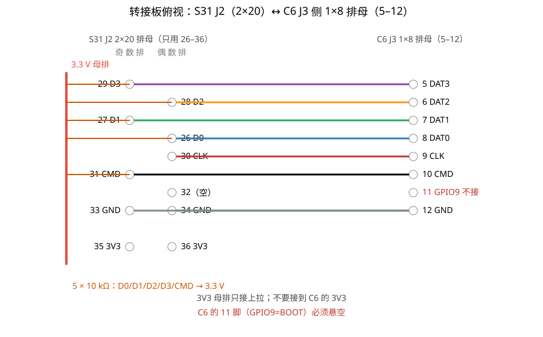
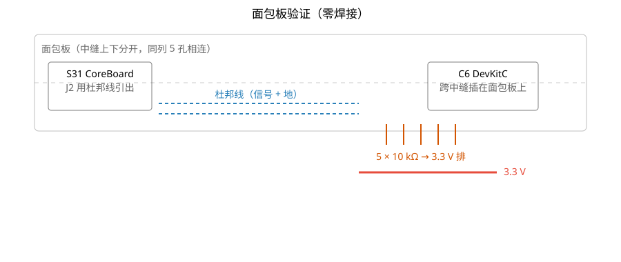

# 从零焊一块 SDIO 转接板：ESP32-S31 Linux ↔ ESP32-C6

> [!abstract] 一句话
> S31 跑 Linux 当主机、C6 当 SDIO 无线从机，飞线在 400 kHz 能枚举，但数据面 CRC/超时。
> 解法是**短排线 + 10 kΩ 上拉**；这块洞洞板转接板把这两件事一次做完：
> 整排插座方案 48 个焊点，杜邦线方案 11 个焊点，另加 5 个上拉电阻，适合第一次动烙铁。

## 1. 为什么要焊这块板

飞线（散杜邦线）在 SDIO 上的真实表现：

| 阶段                 | 飞线 20 cm                        | 说明              |
| -------------------- | --------------------------------- | ----------------- |
| 枚举（400 kHz）      | 能过，偶发重试                    | CMD52 读 CIS 成功 |
| 高速模式             | 枚举成功但数据面 CRC              | `-84 (EILSEQ)`    |
| 寄存器/数据（CMD53） | `-110` 超时、`PACKET_LEN=0x40000` | 错位/丢位         |

最可能的原因是：**没有地回流、没有 10 kΩ 上拉、线太长**。
另一个候选是 S31 的 DW MMC 对**字节模式 CMD53** 的支持问题，尚未完全排除。这块板先解决前三条，再复测。

## 2. 物料清单

| 类别   | 东西                                    | 搜索词                              | 参考价  |
| ------ | --------------------------------------- | ----------------------------------- | ------- |
| 焊接   | 恒温烙铁 60 W                           | `黄花 907 60W 恒温` / `白光 T12`    | ¥60–150 |
| 焊接   | 焊锡丝 0.8 mm 含松香                    | `0.8mm 含松香焊锡丝`                | ¥10     |
| 焊接   | 助焊剂                                  | `松香 助焊膏`                       | ¥5      |
| 焊接   | 斜口钳                                  | `斜口钳 5寸`                        | ¥8      |
| 焊接   | 吸锡带 2 mm                             | `吸锡带 2mm`                        | ¥5      |
| 测量   | 数字万用表（带通断档）                  | `数字万用表 通断`                   | ¥30     |
| 板材   | 洞洞板 7×9 cm 双面                      | `2.54 洞洞板 7x9 双面`              | ¥1      |
| 连接器 | **2×20 排母**（方案 A，整排插 J2）      | `2.54 双排母 2x20P`                 | ¥2      |
| 连接器 | 1×8 单排母（C6 J3 的 5–12）             | `2.54 单排母 40P`（掰 8 针）        | ¥0.5    |
| 连接器 | 方案 B：1×11 单排针 + 11 根母对公杜邦线 | `2.54 单排针 40P` + `杜邦线 母对公` | ¥3      |
| 电阻   | 10 kΩ 1/4 W                             | `1/4W 10K 电阻`                     | ¥2/包   |
| 可选   | 22–33 Ω（信号串阻）                     | `1/4W 22R`                          | ¥2/包   |
| 可选   | 面包板 + 杜邦线（先验证）               | `面包板 MB-102` + `杜邦线 40P`      | ¥8      |

## 3. 先练 10 个焊点（10 分钟）

拿废洞洞板和几根电阻腿：

1. 烙铁调到 **350 °C**，尖上先挂一点锡（吃锡），不挂锡的尖传热很差；
2. 电阻腿插进孔，烙铁尖**同时顶住铜盘和电阻腿**，停 1 秒；
3. 焊锡丝碰**铜盘边缘**（不要碰烙铁尖），锡化开包住焊点；
4. 先撤焊锡丝、再撤烙铁，全程 2–3 秒；
5. 合格焊点：**亮、圆锥形、像小山**；发暗的球/拉尖 = 冷焊，补一次。

练到 10 个里 8 个亮锥形再上正式板。

## 4. 先确认 J2 的物理排布（2×20，不是单排）

CoreBoard-1 的 J2 是 **2×20 = 40 针**（原理图里的 `CON20X2`），针脚编号是"奇偶交替"：1/3/5… 在一排，2/4/6… 在另一排。
所以 26–36 这 11 个脚**分在两排**，单排 1×11 排母盖不住——这是这块板设计里最容易翻车的地方。

两种做法：

| 方案            | S31 侧                            | 焊点数 | 说明                                   |
| --------------- | --------------------------------- | ------ | -------------------------------------- |
| A（推荐，结实） | **2×20 排母**整排插到 J2 上       | 40     | 只接其中 11 个信号，其余焊上只为固定   |
| B（少焊，好用） | 1×11 排针 + **11 根母对公杜邦线** | 11     | 从 J2 逐针引到转接板，线要短（≤10 cm） |

下面按方案 A 画；方案 B 只是把"排母"换成"排针 + 杜邦线"，接线表完全一样。

## 5. 引脚映射（这块板要连的 8 根）

| S31 J2 | 信号 | C6 J3    | 备注                                                  |
| ------ | ---- | -------- | ----------------------------------------------------- |
| 26     | D0   | 8 (DAT0) | 10 kΩ 上拉到 3.3 V                                    |
| 27     | D1   | 7 (DAT1) | 10 kΩ 上拉                                            |
| 28     | D2   | 6 (DAT2) | 10 kΩ 上拉                                            |
| 29     | D3   | 5 (DAT3) | 10 kΩ 上拉；**上电时必须是高电平**（SD/SPI 模式锁存） |
| 30     | CLK  | 9 (CLK)  | 可选串 22 Ω                                           |
| 31     | CMD  | 10 (CMD) | 10 kΩ 上拉                                            |
| 33/34  | GND  | 12 (GND) | 至少两根地线                                          |
| 35/36  | 3V3  | —        | 只给上拉用，**不要**接到 C6 的 3V3                    |

> [!tip] 按丝印找，不要背脚号
> S31 的 J2 上 `D0 D1 D2 D3 CLK CMD` 六针连在一起，`G` 是地，`3V3` 是 3.3 V；
> C6 右排按丝印 `18`（CMD）、`19`（CLK）、`20`–`23`（DAT0–DAT3）和 `G` 找。
> 脚号只是文档里的索引，插线时以丝印为准。

> [!warning] 不要接 C6 的 11 脚
> C6 J3 第 11 脚是 **GPIO9 = BOOT**，上电被拉低会进下载模式。转接板上这个孔留空。

## 6. 转接板布局图



## 7. 焊接步骤

### 方案 A：2×20 排母（40 个焊点）

1. **摆位试插**：2×20 排母和 C6 的 1×8 排母插进洞洞板，不焊；把两块板摆到排母下面试插，确认能同时插上、互不干涉。位置定了再动手。
2. **四角定位**：每个排母只焊两端各一个 pin，检查是否歪；歪了加热拨正。
3. **焊全部引脚**：40 + 8 = 48 个焊点（2×20 里只用到 11 个，其余焊上只为机械固定）。
4. **3.3 V 母排**：用裸铜线把 35/36 两个孔连起来，做成上拉母排。
5. **焊 5 个 10 kΩ**：一端进 D0/D1/D2/D3/CMD 的孔，另一端进 3.3 V 母排。
6. **焊信号线**：按上面的表连接 26→8、27→7、28→6、29→5、30→9、31→10、**33→12、34→12**（两根地线都要接）。
7. **万用表通断档逐条验收**：
   - 26-8、27-7、28-6、29-5、30-9、31-10、33-12、34-12 全部通；
   - 任意两条信号之间**不通**；
   - 3.3 V 与 GND 之间**不通**（否则短路）。
8. **方向验收（上电前必做）**：把转接板插到 J2 上，万用表测 **板子 J2 的 26 脚 ↔ 转接板对应孔**、**J2 的 1 脚 ↔ 排母 1 脚**。
   2×20 排母可以 180° 插反，插反时"板内互通"全部正常但整排信号错位。J2 第 1 脚在丝印 `J2` 那一端（方形焊盘）。

### 方案 B：1×11 排针 + 11 根杜邦线（11 个焊点）

1. 洞洞板上只焊一个 **1×11 排针**（S31 侧）和一个 **1×8 排母**（C6 侧）。
2. 焊 5 个 10 kΩ 到 3.3 V 母排（同上）。
3. 用 **母对公杜邦线**（每根 ≤10 cm）从 S31 的 J2 逐针引到 1×11 排针：
   26→D0、27→D1、28→D2、29→D3、30→CLK、31→CMD、33→GND、35→3V3。
4. 杜邦线尽量**两两和地线拧在一起**，减少串扰。

> [!tip] 怎么确认 J2 是 2×20
> 数一下 J2 的孔：两排、每排 20 个 = 40 针。丝印上 `26`–`36` 分布在两排（奇偶交替），所以单排排母盖不住。

## 8. 上电验证

```sh
# S31 控制台
dmesg | grep -E "new high speed|esp32_sdio"
iw dev
```

- `new high speed SDIO card` + `esp32_sdio: ESP network device detected` → 接线 OK；
- 出现 `wlan0` → 数据面也通了。

如果仍然 CRC/超时，先把 `dts` 里的 `max-frequency` 从 400 kHz 往上抬一档（1 MHz → 12.5 MHz → 25 MHz → 50 MHz），每档看 `dmesg` 里有没有 `-84/-110`，用错误类型判断是线还是时序。

## 9. 新手最容易犯的 5 个错

| #   | 错误              | 后果               |
| --- | ----------------- | ------------------ |
| 1   | 烙铁不挂锡就焊    | 传热慢，焊成球     |
| 2   | 焊锡丝碰烙铁尖    | 松香烧光，焊点发暗 |
| 3   | 单点加热超过 5 秒 | 排母塑料化掉       |
| 4   | 排母焊歪          | 插不进板子         |
| 5   | 不测短路就上电    | 烧芯片             |

## 10. 不想焊？面包板方案

C6 的排针间距是 0.9 英寸，正好跨插在面包板中缝；5 个 10 kΩ 电阻插在面包板上，一端接信号孔、一端接 3.3 V 排；S31 J2 用公对母杜邦线引到面包板。效果一样，只是不结实，适合先验证。



## 11. 一句话总结

枚举过不代表线可以：SDIO 数据面要**短、有地、有上拉**。这块板把三件事做完，剩下的就是调 `max-frequency` 看 CRC。
