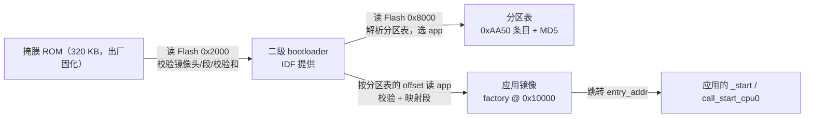

> [!info] Zig × ESP32-S31 全栈开发系列 0. [[zig-esp32-s31|系列索引]]
>
> 1. [[ch01-goal-boundary-hardware|第一章：目标、边界与硬件鉴定]]
> 2. [[ch02-toolchain-first-image|第二章：工具链与第一个可烧录镜像]]
> 3. **第三章：启动链、镜像格式与分区**
> 4. [[ch04-linker-memory-layout|第四章：链接脚本与内存布局]]（下一篇）

# Zig × ESP32-S31 全栈开发（三）：启动链、镜像格式与分区

第二章结束时，我们手里有一个能烧进 Flash 的 `.bin`，但那是个黑盒：`idf.py build` 把它生成出来，`idf.py flash` 把它写进去，中间发生了什么没人解释过。这一章把这个黑盒拆成三层可以逐个字节读懂的格式——**镜像头**、**段表**、**分区表**——并回答一个具体问题：ROM 凭什么相信 Flash 里那段字节是它能跳过去的代码？

答案不神秘：Flash 里有三样东西按固定偏移摆好，各自带自校验。ROM 只认 `0xE9` 开头的镜像；二级 bootloader 只认 `0xAA50` 开头的分区表；应用只认"段能装进地址空间、校验和对得上"。任何一项错位，串口上的表现都是一句 `invalid header` 或者干脆静默重启。

本章的产物不是"点灯"，而是一个**主机侧解析器**：给它一个 `.bin`，它把每个字段、每个段、校验和与摘要都算给你看。这个工具在 ch04 会立刻派上用场——那时镜像由我们自己生成，第一个怀疑对象就是自己的打包逻辑。

---

## 3.1 为什么要读格式，而不是背 API

一个真实场景：你改了一行链接脚本，重新构建，烧进去，串口没有任何输出。可能的原因至少有五个：

| 可能原因                               | 现象                      | 只有读格式才能定位的地方            |
| -------------------------------------- | ------------------------- | ----------------------------------- |
| Flash 模式/容量字段与模组不符          | ROM 阶段就失败，无输出    | common header 第 3 字节的高/低 4 位 |
| 段加载地址落在没有映射的地址空间       | bootloader 校验失败后重启 | 段头的 `load_addr`                  |
| 段长度不是 4 的倍数                    | `elf2image` 直接报错      | 段头 `size` 与段数据的边界          |
| 校验和字节位置被写错（未 16 字节对齐） | 校验失败，反复重启        | 校验和字节的文件偏移                |
| 分区表里 app 分区不是 64 KB 对齐       | bootloader 找不到合法 app | 32 字节条目里的 `offset`            |

这五件事没有一件能在 Zig 源码里看出来。它们全部是**二进制约定**：字段在第几个字节、用什么字节序、覆盖范围到哪结束。把这些约定读明白，排错就从"猜"变成"对照偏移量"。

同时要说清边界：读懂格式**不等于**能自己写 bootloader。本章只做解析（读），生成（写）交给 `esptool elf2image`；自己写 bootloader 是 ch28 的事。

---

## 3.2 启动链：三跳

S31 上电后的控制流只有三跳，每一跳都由上一跳写死在某个偏移上：



| 跳  | 谁做            | 从哪读              | 拿什么做判断                            | 失败表现                    |
| --- | --------------- | ------------------- | --------------------------------------- | --------------------------- |
| 1   | 掩膜 ROM        | Flash `0x2000`      | 首字节 `0xE9`、段表、XOR 校验和         | 无输出，或 ROM 的下载模式   |
| 2   | 二级 bootloader | Flash `0x8000`      | 条目 magic `0xAA50`、类型/子类型、MD5   | `invalid partition table`   |
| 3   | 二级 bootloader | 分区表指定的 offset | app 镜像头的段布局、校验和、可选 SHA256 | `invalid header` / 反复重启 |

三跳里有两条固定的地址事实，值得单独记住：

- **二级 bootloader 在 `0x2000`**。`0x0`–`0x1FFF` 两个扇区保留给出厂用途（esptool 的 S31 目标把 `BOOTLOADER_FLASH_OFFSET` 直接写成 `0x2000`，注释是 "First 2 sectors are reserved for FE purposes"）。这和经典 ESP32 的 `0x1000` 不同，照抄老教程就会把 bootloader 烧到错的地方。
- **分区表在 `0x8000`**，占一个 `0x1000` 扇区，其中前 `0xC00` 字节是表数据；**factory app 从 `0x10000` 开始**，这个偏移必须 64 KB 对齐。

> [!warning] S31 与 ESP32 的偏移不能混用
> `0x1000`（ESP32 bootloader）、`0x8000`（分区表）、`0x10000`（app）这套组合是 ESP32 的；S31 的 bootloader 起点是 `0x2000`。两者的分区表与 app 偏移相同，只有 bootloader 不同——恰好是最容易被"复制粘贴"弄错的那一个。判断依据永远是 `esptool --chip esp32s31` 的目标定义，不是记忆。

---

## 3.3 应用镜像格式：逐字节

一个 ESP 应用镜像（`.bin`）是下面四段拼接：

```text
┌──────────────┬──────────────────┬─────────────────────┬──────────┬─────────────┐
│ common header│ extended header  │ segment headers     │ checksum │ SHA256 (opt)│
│ 8 bytes      │ 16 bytes         │ 8 + data, ×N        │ 1 byte   │ 32 bytes    │
└──────────────┴──────────────────┴─────────────────────┴──────────┴─────────────┘
 offset 0       offset 8           offset 24            16 字节对齐位置
```

### 1. common header（8 字节）

| 偏移 | 长度 | 字段             | 含义                                                                 |
| ---- | ---- | ---------------- | -------------------------------------------------------------------- |
| 0    | 1    | `magic`          | 固定 `0xE9`；不是这个值就不是镜像                                    |
| 1    | 1    | `segment_count`  | 段数，1..16（esptool 的上限）                                        |
| 2    | 1    | `spi_mode`       | 0=QIO、1=QOUT、2=DIO、3=DOUT；S31 文档里的 `--flash-mode dio` 就是 2 |
| 3    | 1    | `spi_speed_size` | 高 4 位 Flash 容量，低 4 位频率（见下表）                            |
| 4    | 4    | `entry_addr`     | 小端 u32；ROM/bootloader 最后跳到这里                                |

`speed/size` 字节的编码是"两个 nibble 各管一件事"，这是最容易读错的一个字段：

| 高 4 位（容量） | 含义   | 低 4 位（频率） | 含义   |
| --------------- | ------ | --------------- | ------ |
| `0x0`           | 1 MB   | `0x0`           | 40 MHz |
| `0x1`           | 2 MB   | `0x1`           | 26 MHz |
| `0x2`           | 4 MB   | `0x2`           | 20 MHz |
| `0x3`           | 8 MB   | `0xF`           | 80 MHz |
| `0x4`           | 16 MB  | 其它            | 保留   |
| `0x5`           | 32 MB  |                 |        |
| `0x6`           | 64 MB  |                 |        |
| `0x7`           | 128 MB |                 |        |

CoreBoard-1 是 16 MB Flash，所以容量 nibble 是 `0x4`；`elf2image --flash-freq 80m` 给出频率 nibble `0xF`，合起来就是 `0x4F`。这两个值**同时**写在镜像头里，写错了 ROM 会在配置 SPI Flash 时就出问题——这就是"改了一行脚本、串口没输出"的典型成因之一。

### 2. 扩展头（16 字节）

ESP32 及之后的镜像在 common header 后面还有 16 字节扩展头。它不靠 magic 识别，首字节是 `wp_pin`（`0xEE` 表示禁用）：

| 相对偏移 | 长度 | 字段                | 含义                                                          |
| -------- | ---- | ------------------- | ------------------------------------------------------------- |
| +0       | 1    | `wp_pin`            | SPI WP 引脚；`0xEE` 表示禁用（ROM 会跳过该字段）              |
| +1       | 1    | `clk_drv` / `q_drv` | 低 4 位 clk、高 4 位 q 的驱动强度                             |
| +2       | 1    | `d_drv` / `cs_drv`  | 低 4 位 d、高 4 位 cs                                         |
| +3       | 1    | `hd_drv` / `wp_drv` | 低 4 位 hd、高 4 位 wp                                        |
| +4       | 2    | `chip_id`           | 芯片 ID；**S31 是 32**                                        |
| +6       | 1    | `min_chip_rev`      | 旧版字段，已被下一个字段取代                                  |
| +7       | 2    | `min_chip_rev_full` | 最小芯片修订，值 = major×100 + minor（如 102 → v1.2）         |
| +9       | 2    | `max_chip_rev_full` | 最大芯片修订                                                  |
| +11      | 4    | `reserved`          | 当前打包器写 `0x00`；非零视为更新版本（解析器只提示，不拒绝） |
| +15      | 1    | `hash_appended`     | 0/1：镜像尾部是否追加 32 字节 SHA256                          |

`chip_id` 是最值得核对的字段：它把"这个镜像给哪颗芯片"写死在二进制里。bootloader 会拿它比对自己的芯片 ID，不匹配就拒绝启动——这是防止把 ESP32 的镜像烧到 S31 上的最后一道闸。

### 3. 段（segment）

扩展头之后是 `segment_count` 个段，每段一个 8 字节头加一段数据：

| 相对偏移 | 长度   | 字段        | 说明                                        |
| -------- | ------ | ----------- | ------------------------------------------- |
| +0       | 4      | `load_addr` | 小端 u32：这段数据要落的地址                |
| +4       | 4      | `size`      | 段数据长度；**必须是 4 的倍数**，且 < 16 MB |
| +8       | `size` | `data`      | 段数据本身                                  |

段的顺序有讲究：**Flash 映射段在前（按地址升序），RAM 段在后**。`elf2image` 会把相邻且可合并的段合并掉，把 Flash 段按 64 KB 页对齐，然后才写头部。

加载地址决定这段数据去哪：

| `load_addr` 范围          | 地址空间       | 什么数据                                                 |
| ------------------------- | -------------- | -------------------------------------------------------- |
| `0x40000000`–`0x54000000` | Flash 映射窗口 | `.flash.text`（IROM）、`.flash.rodata`（DROM）；只读执行 |
| `0x2F000000`–`0x2F07AFC0` | SRAM           | `.data`、`.bss`、IRAM 代码；启动时被拷贝/清零            |
| `0x2E000000`–`0x2E008000` | LP SRAM        | 低功耗域，第一版不用                                     |
| `0x2F800000` 起           | ROM            | 只作为函数地址出现，不是段数据                           |

第一个 Flash 段的 `load_addr` 几乎是固定值 `0x40000020`：文件从 0 到 0x17 是 common header 加扩展头（`0x18` 字节），紧接着 8 字节段头，所以第一个段的**数据**落在 MMU 页内 `0x20` 偏移处。看到 `0x40000020` 就知道"镜像头 + 第一个段头"正好占满了页首的 32 字节——这也解释了为什么 Flash 映射段必须整页对齐。

### 4. 校验和与可选 SHA256

段数据之后是一个**单字节** XOR 校验和：

- 初值 `0xEF`；
- 把**所有段数据**逐字节异或进去（段头不算）；
- 结果写成 1 字节。

它防的是传输/烧录过程中的位翻转，代价几乎为零。但它有个容易踩的细节：**校验和字节位置会对齐到文件的 16 字节边界**，中间空隙补 `0x00`。也就是说"最后一个段结束的位置"和"校验和所在位置"之间可能有 0..15 个填充字节。解析器如果直接从段尾读下一个字节，遇到真实镜像就会读到填充的 0。

`hash_appended = 1` 时，校验和字节之后紧跟 32 字节 SHA256，覆盖范围是**从文件开头到校验和字节（含）为止**：

```text
SHA256 覆盖: [0, checksum_offset + 1)
文件随后:   [checksum_offset + 1, checksum_offset + 33) = 32 字节摘要
```

注意摘要**不覆盖自己**，也不覆盖它之后的任何填充。`elf2image` 默认追加摘要，`--dont-append-digest` 可以关掉；有些老流程为了省几十字节会关掉，代价是丢掉了对整镜像的完整性保护。

---

## 3.4 分区表：`0x8000` 上的 0xC00 字节

二级 bootloader 拿到控制权后做的第一件事，是去 Flash `0x8000` 读分区表。它的布局比镜像更"表格化"：

```text
0x8000 ┌────────────────────────────────────────────┐
       │ entry 0 (32 bytes)                         │
       │ entry 1 (32 bytes)                         │
       │ ...                                        │  表数据区 0xC00 字节
       │ MD5 尾块 (32 bytes: EB EB + 14×FF + 16B)   │
       ├────────────────────────────────────────────┤
       │ 0xFF 填充到扇区末尾                        │  整扇区 0x1000 字节
0x9000 └────────────────────────────────────────────┘
```

三个尺寸要一起记住：**表数据区 `0xC00`**、**整个扇区 `0x1000`**、**每条目 32 字节**。`0xC00 - 16`（MD5 摘要）再按 32 字节切，正好 95 条上限（`(0xC00 - 16) / 32 = 95`）。剩下的 `0x400` 字节留在扇区里给签名等用途。

### 1. 32 字节条目

| 偏移 | 长度 | 字段      | 说明                                                               |
| ---- | ---- | --------- | ------------------------------------------------------------------ |
| 0    | 2    | `magic`   | 字节序 `0xAA 0x50`；表结束处是 `0xFF 0xFF`                         |
| 2    | 1    | `type`    | `0x00` app、`0x01` data、`0x02` bootloader、`0x03` partition_table |
| 3    | 1    | `subtype` | 见下表                                                             |
| 4    | 4    | `offset`  | 分区在 Flash 中的起始偏移（小端 u32）                              |
| 8    | 4    | `size`    | 分区大小（小端 u32）                                               |
| 12   | 16   | `label`   | 名字，不足 16 字节补 `0x00`；OTA 选择、`esp_partition_find` 靠它   |
| 28   | 4    | `flags`   | bit0 = encrypted，bit1 = readonly，其余保留                        |

子类型的取值空间按类型分开，常见组合：

| `type` | `subtype`                | 含义                                   | 对齐      |
| ------ | ------------------------ | -------------------------------------- | --------- |
| `0x00` | `0x00`                   | factory（唯一 app）                    | `0x10000` |
| `0x00` | `0x10`–`0x1F`            | ota_0 … ota_15（A/B 升级槽）           | `0x10000` |
| `0x00` | `0x20`                   | test                                   | `0x10000` |
| `0x01` | `0x00`                   | ota（`otadata`，记录当前从哪个槽启动） | `0x1000`  |
| `0x01` | `0x01` / `0x02`          | phy / nvs                              | `0x1000`  |
| `0x01` | `0x03` / `0x04` / `0x05` | coredump / nvs_keys / efuse            | `0x1000`  |
| `0x01` | `0x81` / `0x82` / `0x83` | fat / spiffs / littlefs                | `0x1000`  |
| `0x02` | `0x00`                   | bootloader（primary）                  | `0x1000`  |
| `0x03` | `0x00`                   | partition_table（primary）             | `0x1000`  |

对齐规则可以直接从这张表读出来：**app 分区 64 KB 对齐**（因为 Flash 映射段按页映射），其余按 4 KB 扇区对齐。bootloader 与分区表的"分区条目"是新版 IDF 引入的类型；经典布局里这两个位置是隐式的（`0x2000` 与 `0x8000`），不占条目。

### 2. MD5 尾块

条目序列之后不是立即结束，而是一个 32 字节的尾块：

```text
+0   EB EB FF FF ... FF   (2 字节 magic + 14 个 0xFF)
+16  MD5(条目数据区)       (16 字节摘要)
```

摘要覆盖的是**它之前的所有条目字节**（不包含尾块自身的 magic 与填充）。它防的是"分区表在 Flash 里被改坏"——比如掉电时擦了一半。校验失败时 bootloader 直接拒绝启动，而不是拿着半张表乱找 app。

### 3. 一张 single-app-large 的表长什么样

IDF 默认的 `single-app-large` 布局（`factory` 吃掉剩余空间）在 Flash 上的形状：

| 偏移      | 大小       | 内容                     | 来源                     |
| --------- | ---------- | ------------------------ | ------------------------ |
| `0x0000`  | `0x2000`   | 保留（出厂用途）         | 芯片约定                 |
| `0x2000`  | ≤ `0x6000` | 二级 bootloader          | esptool S31 目标         |
| `0x8000`  | `0x1000`   | 分区表（表数据 `0xC00`） | IDF 约定                 |
| `0x9000`  | `0x6000`   | `nvs`                    | 默认表条目               |
| `0xF000`  | `0x1000`   | `phy_init`               | 默认表条目               |
| `0x10000` | 剩余空间   | `factory` app            | 默认表条目（64 KB 对齐） |

这张表里只有后三行是**分区条目**，前三行是区域约定。把它们混为一谈，就会出现"我明明写了 bootloader 分区，为什么 bootloader 还是被覆盖"这类问题。

> [!note] 两个布局，两条路线
> `single-app-large` 只有一个 app 分区，OTA 无从谈起；要做 A/B 升级就得换成两槽布局（`ota_0` / `ota_1` + `otadata`），这也是 ch24 的主题。本章只解析，不规划布局；实际偏移以 `build/partition_table/partition-table.bin` 为准。

---

## 3.5 `elf2image` 与 `image-info`：生成与核对

在形态 B（纯 Zig ELF + IDF 二级 bootloader）里，从 ELF 到可烧录镜像这一步由 `esptool` 完成：

```bash
esptool --chip esp32s31 elf2image \
  --flash-mode dio --flash-size 16MB --flash-freq 80m \
  -o app.bin app.elf
```

它做的事，恰好是本章 3.3 节的逆过程：

1. 读 ELF 的段/section，按地址分成 Flash 映射段与 RAM 段；
2. 排序、合并相邻段，把 Flash 段按 64 KB 页对齐（`--flash-mmu-page-size` 可改页大小）；
3. 写 common header（magic、段数、Flash 模式/容量/频率、入口地址）；
4. 写 16 字节扩展头（`chip_id = 32`、修订范围、`hash_appended`）；
5. 逐段写 8 字节段头 + 数据，边写边累加 XOR；
6. 对齐到 16 字节，写校验和字节；
7. 默认追加 SHA256（`--dont-append-digest` 关闭），必要时按 `--pad-to-size` 补齐。

> [!warning] `esp32s31` 仍是 preview target
> IDF v6.1 里 `esp32s31` 需要 `--preview`，且 `--preview` 是 `idf.py` 的**全局**选项，位置在子命令之前：`idf.py --preview set-target esp32s31`。`idf.py build` 内部会调用 `esptool elf2image`，所以你在 `build/` 里拿到的 `.bin` 与手工执行上面这条命令是同一套格式；两者唯一的差别是 IDF 还会额外生成带签名/填充的产物。esptool 本身从 5.2 起支持 `--chip esp32s31`，版本对不上会报 `unknown chip`。

生成之后，核对用它自己的兄弟命令：

```bash
esptool --chip esp32s31 image-info build/app.bin
```

`image-info` **不接触芯片**，只读文件。它做两类事：

| 类别     | 具体内容                                                                          |
| -------- | --------------------------------------------------------------------------------- |
| 结构校验 | magic 是 `0xE9`；扩展头 `hash_appended` 为 0/1；段表能完整走出来；段数据不越界    |
| 内容校验 | XOR 校验和；声明了摘要时重算 SHA256 并比对                                        |
| 字段打印 | 入口地址、Flash 模式/容量/频率、`chip_id`、修订范围、每段的加载地址/长度/文件偏移 |

换句话说：**`image-info` 通过 ≈ 这个镜像的"外壳"是合法的**。它不保证代码正确，也不保证段能装进 RAM——那是 bootloader 真正加载时才会暴露的问题。

除了 `elf2image`，还有一个常被忽略的命令把三样东西按偏移拼成一张可烧录大图：

```bash
esptool --chip esp32s31 merge-bin -o full.bin \
  --flash-mode dio --flash-freq 80m --flash-size 16MB \
  0x2000 build/bootloader/bootloader.bin \
  0x8000 build/partition_table/partition-table.bin \
  0x10000 build/app.bin
```

`merge-bin` 的输出本身就是一份"Flash 布局图"：偏移由命令行给出，谁在哪一段一目了然。它在量产与"整片恢复"场景里比三条 `write-flash` 更不容易错。

---

## 3.6 工程走读：`ch03-image-inspect`

工程在 `practice/zig-esp32-s31/ch03-image-inspect/`，一共三个文件，纯主机侧、零依赖：

| 路径           | 角色                                                     | 代码浏览                                                             |
| -------------- | -------------------------------------------------------- | -------------------------------------------------------------------- |
| `build.zig`    | 主机目标、`addExecutable`、`installArtifact`、`run` 步骤 | [查看](/static/code/#/zig-esp32-s31/ch03-image-inspect/build.zig)    |
| `src/main.zig` | 格式常量、镜像/分区表解析、校验、报表                    | [查看](/static/code/#/zig-esp32-s31/ch03-image-inspect/src/main.zig) |
| `README.md`    | 复现命令、字段示意、退出码、对拍清单                     | [查看](/static/code/#/zig-esp32-s31/ch03-image-inspect/README.md)    |

构建与运行：

```bash
cd practice/zig-esp32-s31/ch03-image-inspect
zig build                    # 产物：zig-out/bin/s31-image-inspect
zig build run -- <file>      # -- 之后的参数经 b.args 传给可执行文件
```

三个退出码：`0` 结构与全部校验通过；`1` 结构非法或校验不匹配（原因打到 stderr）；`2` 命令行参数不对。工具只读文件，不打开串口、不接触芯片，所以在没有板子的机器上也能跑。

### 1. `build.zig`：主机工具，不交叉编译

```zig
const exe = b.addExecutable(.{
    .name = "s31-image-inspect",
    .root_module = b.createModule(.{
        .root_source_file = b.path("src/main.zig"),
        .target = target,
        .optimize = optimize,
    }),
});
b.installArtifact(exe);

const run_cmd = b.addRunArtifact(exe);
run_cmd.step.dependOn(b.getInstallStep());
if (b.args) |args| run_cmd.addArgs(args);
```

和 ch02 的形态 A 相比，这里没有 `-Dtarget=riscv32-...`：工具跑在你的开发机上，读写的是文件，不是寄存器。`standardTargetOptions` 让默认目标就是宿主，需要时可显式指定。`b.args` 那三行是 `zig build run -- <file>` 能工作的原因——`--` 之后的参数才会进 `b.args`。

### 2. `src/main.zig`：五个部分

| 部分                                           | 职责                                                          |
| ---------------------------------------------- | ------------------------------------------------------------- |
| 常量区                                         | magic、头部长度、段数上限、`0xC00`/`0x20`/`0xEBEB` 等格式常量 |
| `readU16` / `readU32`                          | 手写小端读取，不依赖任何字节序辅助函数，读者能逐位看清        |
| `parseAppImage`                                | 严格校验结构，返回一个把所有字段"拆平"的结构体                |
| `reportAppImage`                               | 打印字段；重算 XOR 与 SHA256，返回是否全部通过                |
| `parsePartitionEntry` / `reportPartitionTable` | 32 字节条目 + MD5 尾块；类型/子类型映射成人能读的名字         |

解析的核心是三个必须踩准的偏移，它们直接对应 3.3 节的三条规则：

```zig
// 1) 校验和字节落在 16 字节对齐位置，中间可能有 0..15 个 0x00 填充
const checksum_off = (pos + checksum_align - 1) & ~(checksum_align - 1);

// 2) 段长度必须是 4 的倍数（与 esptool 的写入约束一致）
if (size % 4 != 0) return fail("segment {d}: length 0x{x} is not a multiple of 4", .{ idx, size });

// 3) SHA256 覆盖 [0, checksum_off + 1)，摘要自身不计入
hasher.update(data[0..digest_off]);
```

第二条不是"校验收紧"而是格式事实：`elf2image` 在写段时对非 4 倍数长度直接 fatal，所以一个合法镜像不可能违反它；你的工具如果接受了这种输入，说明它读错了位置。

XOR 校验的实现刻意写成最朴素的循环：

```zig
var computed: u8 = checksum_seed;
for (img.segments[0..img.segment_len]) |seg| {
    for (data[seg.data_off .. seg.data_off + seg.size]) |b| computed ^= b;
}
```

它一次只看一个字节，覆盖范围和"段数据、不含段头"的规则完全对得上；任何优化（SIMD、分块）都应该在读者确认语义之后再做。

### 3. 判定策略：硬错误与提示分开

| 类别     | 例子                                                                                                        | 结果                   |
| -------- | ----------------------------------------------------------------------------------------------------------- | ---------------------- |
| 硬错误   | magic 不对、段数越界、段长非 4 倍数、越界、校验和不符、摘要不符、MD5 不符                                   | 打印原因，退出码 1     |
| 提示     | 扩展头保留字节非 0、段地址未 4 字节对齐、Flash 映射段不在页内 `0x20`、app 分区非 64 KB 对齐、分区越过 16 MB | `note:` 行，退出码不变 |
| 用法错误 | 参数不是恰好一个文件                                                                                        | 打印用法，退出码 2     |

把对齐类问题降级为提示，是因为不同 IDF 版本对非 app 分区的对齐要求并不完全一致；工具要能读历史产物，也要把可疑之处**说出来**而不是隐瞒。

### 4. 输出：字段清单，而不是日志

工具输出的是"这台机器从这个文件里读到了什么"。以镜像为例，骨架是：

```text
[common header]      magic / segment_count / flash_mode / flash_size_freq / entry_addr
[extended header]    wp_pin / pin drive / chip_id / min_rev / max_rev / hash_appended
[segments]           #  加载地址  长度  文件偏移  地址空间
[checksum]           offset / stored / computed / result
[sha256]             offset / stored / computed / result
verdict: OK | FAILED
```

分区表模式下把后两节换成 `[entries]` 和 `[md5]`，并附 `[padding]` 报告表后还有多少 `0xFF`。

> [!warning] 未与真机镜像对拍
> 本工程当前**没有**与任何真实 S31 镜像运行过，也没有与 `esptool image-info` 的输出逐字段比对。字段格式来自 esptool 与 IDF 的源码（见文末来源表），但"两边完全一致"这一步是**待真机验证**。真机产出 `build/*.bin` 后，第一件事就是按 README 的清单把两份输出抄成一张对照表。

---

## 3.7 排错：按偏移量定位

拿到一个不合法的镜像时，别急着改代码，先看工具报的是哪一层：

| 工具报的现象                                      | 说明什么                            | 先查哪里                                       |
| ------------------------------------------------- | ----------------------------------- | ---------------------------------------------- |
| `bad image magic 0x??`                            | 文件不是镜像，或从错误的偏移切出来  | 是不是把分区表/整片 dump 喂进来了；偏移对不对  |
| `segment N: length 0x.. is not a multiple of 4`   | 段长被手工改过，或 ELF 段对齐没处理 | 链接脚本的段对齐；是否手工构造过镜像           |
| `segment N: payload ... past the end of the file` | 文件被截断，或段表被改坏            | 文件大小 vs 各段 `size` 之和                   |
| `checksum: MISMATCH`                              | 段数据被改过，或校验和字节位置算错  | 是否漏了 16 字节对齐的空隙                     |
| `sha256: MISMATCH`                                | 头/段的任何字节被改过（包括填充）   | 是否手工 patch 过镜像头却没重算摘要            |
| 分区表 `magic 0xAA50 missing`                     | 从 `0x8000` 之外的位置切的          | 切的偏移与长度（`0xC00`）                      |
| 分区表 `MD5: MISMATCH`                            | 表被改坏，或只改了条目没重算摘要    | 用 `gen_esp32part.py` 重新生成，而不是手改 bin |

一条实用原则：**手改 `.bin` 是最后手段**。镜像头和分区表都带整段校验，改一个字节就要重算校验和与摘要（分区表还要重算 MD5），所以正确做法是改源（链接脚本/CSV）后重新生成。

---

## 3.8 为什么 ch04 仍然借 IDF 的二级 bootloader

本章把"镜像怎么被读懂"讲完了，但 ch04 的形态 B 依然不自己写 bootloader。理由是分工，而不是能力不足：

| 环节                         | 形态 B 由谁负责                  | 本章的产出如何参与           |
| ---------------------------- | -------------------------------- | ---------------------------- |
| 段布局、`.data/.bss`、栈     | Zig + 自定义链接脚本             | ch04                         |
| ELF → 镜像（头/段/校验）     | `esptool elf2image`              | 本章的解析器用来验证它的产物 |
| 分区表                       | IDF 的 `partitions.csv` + 生成器 | 本章解析条目与 MD5           |
| 读分区表、选 app、校验、跳转 | IDF 二级 bootloader              | 本章解释它读的每一个字段     |
| ROM 加载 bootloader          | 掩膜 ROM                         | 本章解释 `0x2000` 这个偏移   |

值得强调的是入口交接点：二级 bootloader 最后跳到应用镜像的 `entry_addr`。在 IDF 里那个地址是 `call_start_cpu0`；在形态 B 里，它是你自己 `_start` 的地址。两者对 bootloader 没有区别——它只要求这个地址在合法段里、能被映射或已加载。所以 ch04 的关键不是"写个 bootloader"，而是"让 `_start` 落在 bootloader 会跳过去的地方，并把它需要的运行时（栈、`.bss` 清零、`.data` 拷贝）准备好"。

`_start` 里第一个可用的观测手段是 ROM 里的函数。S31 的 ROM 符号在 IDF v6.1 的 `esp32s31.rom.ld` 里给得明白：

```text
ets_printf    = 0x2f800024
ets_delay_us  = 0x2f80003c
```

`esp32s31.rom.api.ld` 再把它们别名成 `esp_rom_printf` / `esp_rom_delay_us`。所以 ch04 的链接脚本可以直接写：

```ld
PROVIDE(esp_rom_printf   = 0x2f800024);
PROVIDE(esp_rom_delay_us = 0x2f80003c);
```

这样即便还没有 UART 驱动，`_start` 也能打印一行证明自己活着——这正是 ch02 里 `esp_rom_printf` 的同一个函数，只是那时它由 IDF 的 `esp_rom` 组件提供，ch04 之后由我们自己的链接脚本钉死地址。

---

## 事实来源

| 事实                                                               | 来源                                                                                                                                                                                                         | 备注                                                                                    |
| ------------------------------------------------------------------ | ------------------------------------------------------------------------------------------------------------------------------------------------------------------------------------------------------------ | --------------------------------------------------------------------------------------- | -------------------------------------------- |
| S31 二级 bootloader 在 `0x2000`，前两个扇区保留                    | [esptool `targets/esp32s31.py`](https://github.com/espressif/esptool/blob/master/esptool/targets/esp32s31.py)                                                                                                | `BOOTLOADER_FLASH_OFFSET = 0x2000`，注释 "First 2 sectors are reserved for FE purposes" |
| S31 的 `chip_id = 32`、IROM/DROM 窗口 `0x40000000`–`0x54000000`    | 同上                                                                                                                                                                                                         | `IMAGE_CHIP_ID = 32`；`IROM_MAP_START/END`                                              |
| 镜像 = 8 字节头 + 16 字节扩展头 + 段 + 校验 + 可选 SHA256          | [esptool 固件镜像格式（ESP32-S31）](https://docs.espressif.com/projects/esptool/en/latest/esp32s31/advanced-topics/firmware-image-format.html)                                                               | 逐字段含义                                                                              |
| 扩展头 16 字节的字段顺序与 `hash_appended` 位置                    | [esptool `bin_image.py`](https://github.com/espressif/esptool/blob/master/esptool/bin_image.py)                                                                                                              | `EXTENDED_HEADER_STRUCT_FMT = "<BBBBHBHH" + "B"*4 + "B"`                                |
| 校验和字节放在 16 字节对齐位置，中间补 `0x00`                      | 同上                                                                                                                                                                                                         | `read_checksum` / `append_checksum` 里的 `align_file_position(f, 16)`                   |
| SHA256 覆盖 `[0, checksum+1)`，摘要不计入自身                      | 同上                                                                                                                                                                                                         | `calc_digest.update(load_file.read(end - start))`                                       |
| 段长必须是 4 的倍数，最多 16 个段                                  | 同上                                                                                                                                                                                                         | `save_segment` 的 `segment_len & 3` 检查、`len(segments) > 16`                          |
| 容量/频率 nibble 编码（16 MB = `0x4`，80 MHz = `0xF`）             | [esptool `targets/esp32.py`](https://github.com/espressif/esptool/blob/master/esptool/targets/esp32.py)、[`targets/esp32c5.py`](https://github.com/espressif/esptool/blob/master/esptool/targets/esp32c5.py) | S31 继承 C5 的频率表；容量表是公共的                                                    |
| `--chip esp32s31`、`elf2image`、`image-info` 自 esptool 5.2 起支持 | [esptool v5.2.0 Release](https://github.com/espressif/esptool/releases/tag/v5.2.0)                                                                                                                           | S31 文档用 `elf2image --flash-mode dio --flash-size 16MB --flash-freq 80m`              |
| 分区表在 `0x8000`、app 在 `0x10000`、表区 `0xC00`、扇区 `0x1000`   | [ESP-IDF 分区表指南](https://docs.espressif.com/projects/esp-idf/en/stable/esp32s31/api-guides/partition-tables.html)                                                                                        | 与 `merge-bin` 示例的偏移一致                                                           |
| 32 字节条目结构 `<2sBBLL16sL`、magic `0xAA50`、类型/子类型取值     | [IDF `gen_esp32part.py`](https://github.com/espressif/esp-idf/blob/v6.1/components/partition_table/gen_esp32part.py)                                                                                         | `STRUCT_FORMAT`、`TYPES`、`SUBTYPES`                                                    |
| MD5 尾块 = `EB EB` + 14×`FF` + 16 字节摘要                         | 同上                                                                                                                                                                                                         | `MD5_PARTITION_BEGIN`；摘要覆盖其前的条目字节                                           |
| 最多 95 条条目、表后按 `0xFF` 填充到 `0xC00`                       | 同上                                                                                                                                                                                                         | `MAX_PARTITION_LENGTH = 0xC00`；`(0xC00-16)/32 = 95`                                    |
| 对齐：app `0x10000`、其余 `0x1000`                                 | 同上                                                                                                                                                                                                         | `ALIGNMENT` 表                                                                          |
| SRAM `0x2F000000`–`0x2F07AFC0`、LP RAM `0x2E000000`–`0x2E008000`   | 本仓系列索引与 IDF `memory.ld.in`（`SRAM_SEG_END`）                                                                                                                                                          | 段地址归属判定用                                                                        |
| ROM 符号 `ets_printf = 0x2f800024`、`ets_delay_us = 0x2f80003c`    | IDF v6.1 `esp32s31.rom.ld`；`esp32s31.rom.api.ld` 提供 `esp_rom_*` 别名                                                                                                                                      | ch04 的 `PROVIDE(...)` 用                                                               |
| `esp32s31` 在 IDF v6.1 是 preview target                           | [practice/onvif-labs/SPEC.md](https://github.com/hlwqds/hl-ljj-quartz/blob/v4/practice/onvif-labs/SPEC.md)、[[ch11-esp32s31-lab-plan                                                                         | ONVIF 第十一章]]                                                                        | `set-target`/`list-targets` 必带 `--preview` |

## 自查清单

进入第四章前，确认能回答这些问题：

- [ ] 上电到 `app_main` 的三跳分别从哪里读数据？S31 的二级 bootloader 为什么在 `0x2000` 而不是 `0x1000`？
- [ ] common header 第 3 字节怎么同时编码 Flash 容量与频率？CoreBoard-1 的 16 MB + 80 MHz 对应哪两个 nibble？
- [ ] 扩展头的 `chip_id` 是多少？它不匹配时会发生什么？
- [ ] 为什么第一个 Flash 映射段的加载地址是 `0x40000020`？页首 32 字节被谁占了？
- [ ] XOR 校验和的初值、覆盖范围、写入位置分别是什么？为什么它不覆盖段头？
- [ ] SHA256 覆盖到哪个字节为止？为什么它不覆盖自己？`--dont-append-digest` 的代价是什么？
- [ ] 分区表条目为什么最多 95 条？`0xC00` 与 `0x1000` 的关系是什么？
- [ ] MD5 尾块的 32 字节里，哪 16 字节是摘要、哪 14 字节是填充、头两个字节是什么？
- [ ] app 分区为什么必须 64 KB 对齐？`0x10000` 这个偏移是从哪来的？
- [ ] `image-info` 通过能证明什么、不能证明什么？
- [ ] 如果烧录后串口毫无输出，按什么顺序怀疑：Flash 模式字段、段地址、校验和、分区表？

---

下一章把这些格式接到自己的构建链上：写一份自定义链接脚本，把 `.flash.text`/`.flash.rodata`/`.data`/`.bss` 摆到 `0x40000020`、`0x2F000000` 这些地址上；写一个只有几十条指令的 `_start`，设栈、清 `.bss`、拷 `.data`，再用 `esp_rom_printf` 打印一行；最后用 `elf2image` 打包，用本章的工具和 `image-info` 双重核对。第四章：[[ch04-linker-memory-layout|链接脚本与内存布局]]。

系列导航：[[ch02-toolchain-first-image|上一章]] · [[zig-esp32-s31|系列索引]]
