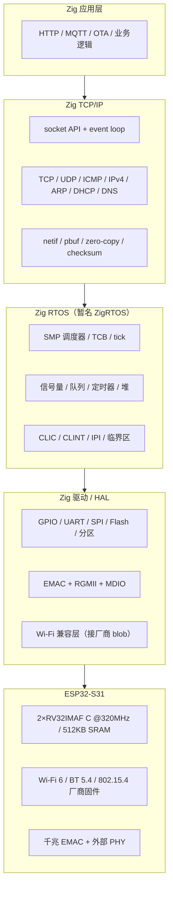

# Zig × ESP32-S31 全栈开发系列

> [!tip] 系列说明
> 这是一条**用 Zig 从零写满一颗 SoC** 的教学路线：应用是 Zig，TCP/IP 是 Zig，RTOS 也是 Zig；只有芯片掩膜 ROM 与射频固件这两块厂商二进制不在重写范围内。
>
> 目标板是 **ESP32-S31-Function-CoreBoard-1**（ESP32-S31-WROOM-3，16 MB Flash + 16 MB PSRAM，千兆以太网、USB HS OTG、USB Serial/JTAG）。选择它而不是经典 ESP32/S3，是因为 **S31 是双核 RISC-V**：上游 Zig 直接支持 `riscv32`，不需要维护 Xtensa 编译器分支。这是整条路线能成立的前提。
>
> 读者画像是"写过 C 裸机、用过 FreeRTOS/lwIP、想真正掌握 Zig 与全栈构造"的工程师。系列不假设你读过 Zig 源码，但假设你愿意读汇编、手册与抓包。

> [!warning] 当前状态：第 1–15 章已落地
> 本页是系列的**路线图 / 总索引**；第 1–15 章已发布，其余 13 章仍为规划状态。已发布章节的标题已替换为 wikilink，未发布章节保持纯文本，避免死链。

## 0. 先把坐标钉死：S31 是 RISC-V，不是 Xtensa

ESP32 家族有两个容易混淆的"高性能"分支：

| 芯片          | CPU 内核                   | Zig 工具链现状                                   |
| ------------- | -------------------------- | ------------------------------------------------ |
| ESP32-S3      | Xtensa LX7 双核            | 上游 Zig 不支持；需要 Espressif LLVM/Xtensa 分支 |
| **ESP32-S31** | **RISC-V RV32IMAF C 双核** | **上游 Zig 0.17.x 的 RISC-V 后端直接可用**       |

S31 的关键规格（与本系列直接相关）：

| 项       | 事实                                                                               | 对路线的影响                                                                             |
| -------- | ---------------------------------------------------------------------------------- | ---------------------------------------------------------------------------------------- |
| CPU      | 双核 32 位 RISC-V，最高 320 MHz；RV32IMAF C；单精度 F，无 D                        | 上下文切换要保存 F 寄存器；ABI 与 IDF 侧实际 `-mabi` 对齐（预期 `ilp32f`，首次构建核对） |
| 存储     | 512 KB SRAM、320 KB ROM、32 KB LP SRAM；模块 16 MB Flash + 16 MB PSRAM             | 链接脚本、堆预算、PSRAM 初始化与 cache 约束                                              |
| 中断     | 每核 CLIC 48 路、8 个优先级；CLINT；169 个中断矩阵源；4 个软件中断                 | OS 的 tick、IPI、外设中断分发全部要自己接                                                |
| 无线     | Wi-Fi 6 1T1R（802.11b/g/n/ax，最高 150 Mbps）、BT 5.4、802.15.4                    | 射频/MAC 是厂商 blob，构成"全 Zig"的硬边界                                               |
| 有线     | 千兆 Ethernet MAC + RGMII PHY（板载 RJ45）                                         | **可以 100% 用 Zig 驱动**，作为无 blob 的对照路径                                        |
| 调试     | USB Serial/JTAG、USB-to-UART 双口                                                  | 串口日志、OpenOCD/GDB 两条调试通道                                                       |
| 板载外设 | RGB LED（GPIO60）、ES8311 codec、麦克风/扬声器、UART0（GPIO58/59）、BOOT（GPIO61） | 前几章的点灯、串口、音频支线                                                             |

> [!note] 口径
> S31 的数据手册目前是 **Pre-release v0.7**，IDF 支持版本是 **v6.1（`esp32s31` 为 preview target）**；CLIC 路数、内存区间等细节以写作时的 TRM/头文件为准。本页先钉住"双核 RISC-V + 512 KB SRAM + CLIC + 千兆 EMAC"这四个对架构决策有影响的事实。

### 0.1 为什么 RISC-V 是这条路线最大的红利

Zig 的 RISC-V 后端是上游一线维护的：`riscv32-freestanding`、`riscv32-freestanding-eabihf`、`generic_rv32` 与 `+m/+a/+c/+f/+zicsr/+zifencei` 这些目标能力都在 `std.Target.riscv` 里。S31 不需要 LLVM 分支、不需要 `zig cc` 包装 Xtensa GCC、不需要给 Zig 打补丁；需要自己写的是 **CLIC/CLINT、启动代码、链接脚本、RTOS 与协议栈**——这些正是本系列要教的内容。

工具链冒烟命令（本页写作时已在 Zig 0.17.1 / Windows x86_64 实测通过）：

```bash
zig build-lib --show-builtin \
  -target riscv32-freestanding-eabihf \
  -mcpu=generic_rv32+m+a+c+f+zicsr+zifencei
```

实测结果：`abi = .eabihf`、`arch = .riscv32`、`model = generic_rv32`，特性集含 `m/a/c/f/i/zicsr/zifencei`（以及由它们推导的 `zaamo/zalrsc/zca/zmmul`）；同一组参数下 `zig build-obj` 成功产出 RISC-V 目标文件。把 `builtin.zig` 存档进实验工程，作为"编译器到底按什么 ISA/ABI 生成代码"的证据；第一章会把它扩成完整的构建 + 烧录验收。

S31 还支持 B 位操作扩展（Linux 移植的 `-march` 里带 `b`），但第一版 Zig 目标先不启用：先把最小 ISA 跑通，性能章再评估 `+b` 的收益与编译器成熟度。

### 0.2 现有 Zig/ESP 生态怎么用

| 项目                                                                        | 定位                                     | 在本系列里的用法                                                    |
| --------------------------------------------------------------------------- | ---------------------------------------- | ------------------------------------------------------------------- |
| [microzig](https://github.com/ZigEmbeddedGroup/microzig)                    | Zig 嵌入式 HAL/板级框架                  | 借它的抽象思路；不把 OS/TCP 栈外包给它（它也不提供）                |
| [kassane/zig-esp-idf-sample](https://github.com/kassane/zig-esp-idf-sample) | Zig × ESP-IDF 集成样例（C3/C6/P4/S3 等） | 形态 A 的参考：Zig 静态库如何导出 `app_main`、如何与 IDF CMake 对接 |
| [esp-hal](https://github.com/esp-rs/esp-hal)（Rust）                        | ESP32 系列外设/寄存器元数据              | 交叉核对 S31 的 CLIC/内存/外设定义；不是依赖，是"第二意见"          |
| [esp-emulator](https://github.com/espressif/esp-emulator)                   | Espressif 官方模拟器                     | S31 早期 bring-up 冒烟；不假设它覆盖 EMAC/CLIC 全部门控             |

> 结论：本系列不建立在某个"Zig ESP32 框架"之上。HAL 抽象、IDF 互操作、寄存器定义各自借力，但 OS、协议栈与构建主线保持自持，避免被上游实验性接口绑架。

## 1. "完全 Zig"到底完整到什么程度

先把边界说清楚，后面 28 章才不会变成"许愿池"。

| 层                         | 能否用 Zig 重写 | 说明                                                                |
| -------------------------- | --------------- | ------------------------------------------------------------------- |
| 芯片掩膜 ROM / 一级引导    | ❌ 不能         | 出厂固化，负责下载模式、二级引导加载、基础 ROM 函数                 |
| 二级 bootloader            | ✅ 能           | 先借 IDF 的；ch28 再用 Zig 写自己的，做 A/B、校验与回滚             |
| RTOS 内核 / 驱动 / HAL     | ✅ 能           | 调度、IPC、堆、CLIC、UART、SPI、Flash、EMAC 全部 Zig                |
| TCP/IP 协议栈              | ✅ 能           | ARP/IPv4/ICMP/UDP/TCP/DHCP/DNS/HTTP/MQTT，全部自写                  |
| Wi-Fi PHY / MAC            | ❌ 不能         | `libnet80211`/`libpp`/`libphy` 等厂商二进制，必须保留               |
| Wi-Fi 主机侧（supplicant） | ✅ 能，但很难   | WPA2/WPA3、EAPOL、SAE 可以 Zig 写；第一版先接 IDF 的开源 supplicant |
| BT controller              | ❌ 不能         | 控制器固件是 blob；主机栈（GATT 等）可以 Zig 写                     |
| TLS / HTTP / MQTT / OTA    | ✅ 能           | 用 `std.crypto` 原语自建记录层，或先接 mbedTLS 做对照               |

于是本系列给"完全 Zig"一个可验收的定义：

1. **纯 Zig 路径**：从二级 bootloader 到应用，全部 Zig；网络走板载千兆以太网。这条路径**没有射频 blob**，可以作为"全 Zig 能做到什么程度"的硬证据。
2. **无线路径**：Wi-Fi/蓝牙的射频与 MAC 保留厂商 blob；blob 以上的 OS 适配层、supplicant、TCP/IP、应用全部 Zig。边界写进文档，不假装不存在。
3. **不碰的东西**：不重写掩膜 ROM、不重写 Wi-Fi PHY、不做 Linux 级虚拟内存/进程模型、不做蓝牙控制器认证。

> [!important] 一句话
> "完全 Zig"不是"每一行机器码都来自 Zig"，而是"**所有可替换的软件层都由 Zig 实现，且边界可解释、可测量、可复现**"。

## 2. 目标架构：五层，接口先定死



| 层     | 本系列的职责                          | 关键接口                                  | 验收方式                       |
| ------ | ------------------------------------- | ----------------------------------------- | ------------------------------ |
| 应用   | HTTP 服务、MQTT 客户端、OTA、综合项目 | socket / event loop / 文件与 KV           | 端到端业务跑通                 |
| 协议栈 | 自写 TCP/IP；先以太网，后 Wi-Fi       | `netif` 收发帧、pbuf 生命周期、socket API | 抓包 + 吞吐/时延数据           |
| RTOS   | 抢占调度、SMP、IPC、时间、堆、临界区  | TCB / 队列 / 信号量 / 定时器 / 中断注册   | 压力测试 + 优先级反转/双核实验 |
| HAL    | 寄存器级驱动；中断与 DMA              | MMIO、CLIC 路由、DMA 描述符、cache 维护   | 逻辑分析仪/示波器 + 寄存器回读 |
| 硬件   | 只读手册与板卡；不修改芯片            | TRM / datasheet / 原理图                  | 实测波形、功耗、温度           |

## 3. 工具链与三阶段构建

### 3.1 工具链矩阵

| 工具          | 版本 / 来源                          | 用途                                                       | 备注                                                             |
| ------------- | ------------------------------------ | ---------------------------------------------------------- | ---------------------------------------------------------------- |
| Zig           | 0.17.1 stable（2026-11-02）          | 编译、链接、`build.zig`、主机侧单元测试                    | 锁定版本；不追 master                                            |
| ESP-IDF       | v6.1（`esp32s31` 为 preview target） | S31 支持、厂商 blob、二级 bootloader 参照、esptool/OpenOCD | 命令带 `--preview`；纯 Zig 路径只把它当"二进制供应商 + 对照实现" |
| esptool       | ≥ 5.2（S31 支持）                    | 镜像生成、烧录、`image-info`、全片备份                     | `elf2image` 是纯 Zig ELF 进 ROM 的关键                           |
| esp-emu       | Espressif ESP32 emulator             | S31 早期 bring-up 的冒烟与 CI                              | 外设模型不完整，不能替代真机                                     |
| OpenOCD + GDB | IDF 工具链自带                       | USB Serial/JTAG 调试、断点、panic 回溯                     | 与 UART 日志双通道                                               |
| 主机          | Linux 优先；Windows 用 EIM 也可      | 构建、抓包、串口                                           | 本仓写作环境为 Windows，命令给双平台口径                         |

### 3.2 三种构建形态，按章节逐步切换

| 形态 | 做法                                                                                      | 用在哪            | 代价 / 收益                                    |
| ---- | ----------------------------------------------------------------------------------------- | ----------------- | ---------------------------------------------- |
| A    | Zig 编译静态库，IDF CMake 工程链接；`app_main` 由 Zig 导出                                | ch1–ch6 快速点名  | 最快跑通；但构建链仍有 IDF/CMake               |
| B    | Zig 直接产出 ELF + 自定义链接脚本；`esptool elf2image` 生成镜像；IDF 二级 bootloader 加载 | ch7 之后的主线    | 构建链纯 Zig；需要自己处理启动、段布局、镜像头 |
| C    | Zig 写二级 bootloader + 应用；自带分区/校验/回滚                                          | ch28 收官（可选） | 最彻底；风险最高，放在最后                     |

主线走 **B**：它既证明"Zig 能独立产出一个可启动镜像"，又暂时借用 IDF 的二级 bootloader，避免一上来就掉进 ROM 加载细节。形态 A 只作为 bring-up 的脚手架，跑通后即删除，不进入长期架构。

### 3.3 内存与镜像的第一张底图

| 区域         | 地址 / 大小（待以链接脚本复核） | 用途                                   |
| ------------ | ------------------------------- | -------------------------------------- |
| SRAM / DRAM  | `0x2F00_0000` 起，约 512 KB     | `.data`、`.bss`、堆、任务栈、DMA 缓冲  |
| ROM          | 320 KB                          | ROM 函数（可选复用）；不作为主代码区   |
| LP SRAM      | 32 KB                           | 低功耗域；第一版不用，留作后续         |
| Flash (mmap) | 16 MB                           | bootloader、分区表、应用、OTA 槽、资源 |
| PSRAM        | 16 MB（Octal）                  | 网络缓冲、素材、大块内存；初始化后可用 |
| 中断 / 外设  | CLIC 48 路/核；矩阵 169 源      | 驱动与 OS 的路由表                     |

> [!warning] 三个硬约束
>
> 1. **Flash 写/擦期间 cache 会被关**：ISR 与关键代码必须放在 IRAM，数据放 DRAM；否则会出现"偶发 cache error"。
> 2. **PSRAM 不是万能堆**：cache miss 延迟、DMA 可达性、初始化时序都要单独验证；ISR 与关键路径不放 PSRAM。
> 3. **浮点 ABI 必须钉死**：Zig 侧用 `eabihf`；IDF 侧预期 `ilp32f`，但以首次构建的 `-mabi` 为准；链接 blob 前必须逐项核对。

### 3.4 实验台最小配置

| 设备                        | 用途                                                         | 必需? |
| --------------------------- | ------------------------------------------------------------ | ----- |
| CoreBoard-1 + 两根 USB-C 线 | 供电、UART 控制台、USB Serial/JTAG 调试                      | 必需  |
| 千兆交换机/路由器 + 网线    | 以太网协议栈验证；能开 DHCP 与抓包                           | 必需  |
| 支持 WPA2/WPA3 的 AP        | ch26 的 Wi-Fi 连接与重连测试                                 | 必需  |
| 逻辑分析仪（≥8 通道）       | 中断延迟、GPIO 翻转、SPI/UART 时序；没有就用 GPIO+示波器替代 | 推荐  |
| 万用表 + 板载 J5 电流测量   | 功耗章、供电完整性排查                                       | 推荐  |
| Linux 主机或 Wireshark      | 抓包、对比 TCP 状态机、镜像/串口脚本                         | 推荐  |

## 4. 路线图：28 章，六个阶段

### Part I：地基（ch01–ch04）

先把板子、工具链、镜像格式、链接布局四件事钉死。没有这四块，后面的"OS/协议栈"都是沙上建塔。

| #   | 章节                                                     | 核心内容                                                                                        | 验收产物                                             |
| --- | -------------------------------------------------------- | ----------------------------------------------------------------------------------------------- | ---------------------------------------------------- |
| 1   | [[ch01-goal-boundary-hardware\|目标、边界与硬件鉴定]]    | S31 规格、全 Zig 边界、板卡接口、验收矩阵；`esptool` 读芯片/Flash、全片备份                     | 板卡鉴定记录、16 MB 备份、风险清单                   |
| 2   | [[ch02-toolchain-first-image\|工具链与第一个可烧录镜像]] | Zig 0.17.1、target/CPU 特性、`build.zig`、`elf2image`、UART 输出（WS2812 需 RMT，留到后续章节） | `hello s31` 串口输出；`builtin.zig` 存档；镜像可烧录 |
| 3   | [[ch03-boot-image-partition\|启动链、镜像格式与分区]]    | ROM → 二级 bootloader → app；8 字节头/扩展头/段/校验；分区表与 OTA 槽                           | 手写镜像解析器；`image-info` 对得上；分区图          |
| 4   | [[ch04-linker-memory-layout\|链接脚本与内存布局]]        | IRAM/DRAM/IROM/DROM、cache/MMU、PSRAM、`_start`、`.data/.bss`、栈                               | 自己的链接脚本；map 文件；`_start` 跑通              |

### Part II：裸机运行时（ch05–ch09）

把 CPU 与外设真正握在手里：时钟、串口、中断、定时器、Flash。每一步都要有可观测证据，不靠"应该能跑"。

| #   | 章节                                                         | 核心内容                                                                                      | 验收产物                                    |
| --- | ------------------------------------------------------------ | --------------------------------------------------------------------------------------------- | ------------------------------------------- |
| 5   | [[ch05-clock-reset-watchdog\|时钟、复位与看门狗]]            | 40 MHz XTAL、PLL、320 MHz、SYSTIMER/TIMG、WDT、复位原因                                       | 时钟树实测；WDT 喂狗/超时实验；复位原因打印 |
| 6   | [[ch06-gpio-uart-logging-panic\|GPIO、UART、日志与 panic]]   | IO_MUX/GPIO 矩阵、UART FIFO（轮询）+ 环形缓冲、分级日志、mtvec trap 现场打印；WS2812/RMT 边界 | 轮询收发的串口 shell；panic 能打印 PC/栈    |
| 7   | [[ch07-interrupts-exceptions-clic\|中断、异常与 CLIC]]       | `mtvec/mepc/mcause/mstatus`、CLIC 48 路/8 级、169 源矩阵、ISR 分发、临界区                    | 1 kHz tick + 按键中断；嵌套/屏蔽实验        |
| 8   | [[ch08-timers-dma-precision\|定时器、DMA 与精确时序]]        | GPTimer、SYSTIMER、GDMA、延迟/超时、GPIO 翻转测抖动                                           | 微秒级延迟误差报告；DMA 搬运实验            |
| 9   | [[ch09-spi-flash-partition-nvs\|SPI Flash、分区与 NVS 存储]] | SPI0/1、cache、读/写/擦、分区解析、KV/日志式存储、掉电安全                                    | 掉电重启后配置不丢；擦写寿命/坏块策略记录   |

### Part III：Zig RTOS（ch10–ch15）

这一部分是"操作系统"的主体：上下文切换、调度、IPC、内存、SMP、可观测性。每章都先在主机侧测数据结构，再上真机测时序。

| #   | 章节                                                                | 核心内容                                                              | 验收产物                                     |
| --- | ------------------------------------------------------------------- | --------------------------------------------------------------------- | -------------------------------------------- |
| 10  | [[ch10-context-switch-cooperative-scheduler\|上下文切换与协作调度]] | RV32 调用约定、callee-saved、栈帧、F 寄存器、汇编切换、首个双任务调度 | 两个任务各自栈上跑；GPIO 翻转测切换开销      |
| 11  | [[ch11-preemptive-scheduler-tcb-tick\|抢占调度、TCB 与 tick]]       | TCB、就绪队列、优先级、时间片、idle、tickless、软件中断 yield         | 3 任务抢占调度；tick 漂移/抖动数据           |
| 12  | [[ch12-sync-primitives-ipc\|同步原语与 IPC]]                        | 自旋锁（A 扩展）、关中断、信号量、互斥量+优先级继承、队列、事件组     | 生产者/消费者；优先级反转复现与修复          |
| 13  | [[ch13-heap-stack-caps\|堆、栈保护与内存 caps]]                     | TLSF/slab、对齐、IRAM/DRAM caps、栈哨兵、溢出检测、PSRAM 分配器       | 碎片化压测；栈溢出被捕获；内存预算表         |
| 14  | [[ch14-dual-core-smp-ipi\|双核 SMP 与 IPI]]                         | core1 启动、每核数据、CLIC 软件中断、跨核唤醒、负载均衡、内存屏障     | 双核各跑任务；跨核唤醒延迟数据               |
| 15  | [[ch15-observability-testing-stability\|可观测性、测试与稳定性]]    | 主机单测、断言、trace、watchdog、压测、panic dump                     | 1 小时稳定性报告；失败用例归档；trace 时间线 |

### Part IV：网络底座（ch16–ch19）

从"能收发以太网帧"到"能 ping、能拿 DHCP、能解析 DNS"。这一部分先把无 blob 的路径打通，为后面的 TCP 和 Wi-Fi 提供对照基线。

| #   | 章节                     | 核心内容                                                        | 验收产物                           |
| --- | ------------------------ | --------------------------------------------------------------- | ---------------------------------- |
| 16  | 协议栈架构、缓冲与零拷贝 | netif、pbuf/ownership、checksum、timer wheel、主机 TAP 测试骨架 | 主机侧收发包测试；零拷贝路径图     |
| 17  | 以太网 MAC/PHY 驱动      | RGMII、MDIO、DMA 描述符环、cache 维护、中断/轮询、PHY 自协商    | PHY ID 读通；ARP/ping 通；抓包对照 |
| 18  | IPv4、ICMP、ARP 与路由   | 首部/校验和、分片、ARP 缓存、路由表、MTU/PMTU                   | 跨网段 ping；分片重组测试          |
| 19  | UDP、DHCP 与 DNS         | 端口/校验和、重传、DHCP 状态机、DNS 解析器                      | 从路由器拿到 IP；域名解析成功      |

### Part V：TCP/IP 与应用（ch20–ch24）

从 TCP 状态机到 HTTPS/MQTT。这里开始出现"协议栈真正难的部分"：定时器、重传、窗口、连接生命周期。

| #   | 章节                       | 核心内容                                                         | 验收产物                           |
| --- | -------------------------- | ---------------------------------------------------------------- | ---------------------------------- |
| 20  | TCP 状态机与可靠传输       | 三次握手、seq/ack、RTO、重传、乱序、FIN/RST、TIME_WAIT           | echo server；抓包对照状态机        |
| 21  | TCP 拥塞控制与吞吐         | 慢启动、拥塞避免、快重传/快恢复、窗口缩放、Nagle/延迟 ACK        | 吞吐/时延曲线；与 lwIP 对照        |
| 22  | Socket API、事件循环与测试 | 阻塞/非阻塞、poll、超时、连接池、主机侧回归测试                  | 可用的 socket 层；主机测试全绿     |
| 23  | TLS 与 HTTP                | `std.crypto` 原语、TLS 记录层、证书校验、HTTP/1.1 服务端与客户端 | 浏览器访问板端页面；HTTPS GET 成功 |
| 24  | MQTT、OTA 与应用协议       | MQTT 3.1.1、QoS、主题、OTA 镜像校验/回滚、应用分层               | MQTT pub/sub；OTA 升级成功并可回滚 |

### Part VI：Wi-Fi、多协议与产品化（ch25–ch28）

这一部分直面"全 Zig"的硬边界：厂商 blob 怎么接、OS 怎么兼容、最后怎么把整栈跑成一个可交付的系统。

| #   | 章节                        | 核心内容                                                                    | 验收产物                                              |
| --- | --------------------------- | --------------------------------------------------------------------------- | ----------------------------------------------------- |
| 25  | Wi-Fi blob 边界与兼容层     | `libnet80211/libpp/libphy`、IDF adapter、FreeRTOS/IDF API 面、混合/垫片方案 | 依赖清单；最小可链接 demo；决策记录（混合 vs 兼容层） |
| 26  | Wi-Fi 连接管理（WPA2/WPA3） | scan/connect、事件循环、重连、WPA2-PSK/WPA3-SAE、DHCP over Wi-Fi            | 连上 AP 并拿到 IP；断线重连测试                       |
| 27  | BLE / 802.15.4（选修）      | controller blob + host stack 边界；GATT/Thread 的最小实验                   | 能扫描/连接/读一个特征值；或 Thread 节点加入网络      |
| 28  | 自举、功耗、性能与综合项目  | Zig 二级 bootloader、A/B/回滚、功耗模式、性能剖析、端到端演示               | 一条命令构建/烧录；综合 demo；性能/功耗报告           |

### 阶段门（Gate）

| 阶段 | 章节  | 通过条件（缺一不可）                                            |
| ---- | ----- | --------------------------------------------------------------- |
| G0   | 1–4   | 干净环境能复现 `hello s31`；`image-info` 通过；map/段布局可解释 |
| G1   | 5–9   | 自己的 `_start` 跑通；CLIC tick/UART 中断稳定；掉电后配置不丢   |
| G2   | 10–15 | 3 任务抢占 + 优先级反转实验 + 双核各跑任务 + 1 小时压测无重启   |
| G3   | 16–19 | 千兆口 ping/DHCP/DNS 通；抓包能逐字段对上                       |
| G4   | 20–24 | TCP echo/吞吐达标；HTTP 可访问；TLS 握手成功；MQTT 通           |
| G5   | 25–26 | Wi-Fi 连 AP、DHCP、MQTT 通；blob 依赖与 ABI 边界有文档          |
| G6   | 27–28 | 综合项目可演示；OTA 可回滚；性能/功耗有数据                     |

> [!note] 关于"达标"
> 本系列不预设虚构的吞吐/时延数字。每个 Gate 的量化目标在该章实验里先定义测量方法（抓包、GPIO 翻转、逻辑分析仪、`esp_timer`），再记录实测值，并与 IDF/lwIP 的对照实现比较。**先有测量，后有指标**。

## 5. 每阶段怎么教、怎么验

### P0 地基：把"能烧进去"变成"能解释"

- **教学重点**：S31 的启动链不是"上电跑 main"，而是 ROM → 二级 bootloader → 应用镜像；镜像头/段/校验和是可以在十六进制里逐字节读懂的。
- **关键实验**：`esptool` 读芯片与 Flash、全片备份；`image-info` 解析官方镜像；手写一个镜像头解析器；空 `_start` + 链接脚本 + `elf2image`。
- **取证**：串口日志、`esptool image-info` 输出、map 文件、反汇编。
- **常见坑**：USB Serial/JTAG 与 UART 两个口混淆；Flash 模式/大小填错导致不启动；BOOT 引脚电平；S31 文档是 pre-release，寄存器名与 IDF 头文件可能不完全一致。

### P1 裸机运行时：先观测，再抽象

- **教学重点**：时钟树、CLIC、UART FIFO、DMA 不是"调 API"，而是"配置寄存器 + 处理并发 + 测量时序"。
- **关键实验**：用 GPIO 翻转 + 逻辑分析仪测中断延迟；UART 中断收发 + 环形缓冲；CLIC 优先级/嵌套；Flash 擦写时 ISR 的 IRAM 约束。
- **取证**：示波器/逻辑分析仪波形、寄存器回读、串口时间戳。
- **常见坑**：cache 关闭窗口访问 Flash 代码；ISR 里调用非 IRAM 函数；FPU 使用与上下文保存；看门狗在长擦除时误复位。

### P2 Zig RTOS：先单核正确，再双核并行

- **教学重点**：上下文切换是"保存哪些寄存器、栈怎么长、谁决定下一个任务"；调度器的正确性靠不变量与压力测试，不靠"看起来能跑"。
- **关键实验**：两个任务用不同栈交替打印；优先级反转（低优先级持锁、高优先级等锁、中优先级插队）；双核 IPI 唤醒延迟；堆碎片化压测。
- **取证**：GPIO 翻转测切换开销、trace 时间线、堆水位、栈哨兵。
- **常见坑**：栈 16 字节对齐；F 寄存器未保存；临界区里关中断过久；CLIC 嵌套与优先级；SMP 下的内存屏障与 per-CPU 数据。

### P3 网络底座：以太网是"无 blob 的诚实路径"

- **教学重点**：DMA 描述符环的 ownership、cache 一致性、端序/校验和、PHY 自协商；这些是协议栈性能与稳定性的地基。
- **关键实验**：MDIO 读 PHY ID；RGMII 收发环；ARP/ping；DHCP 拿地址；Wireshark 对照。
- **取证**：抓包、描述符 dump、吞吐/丢包统计。
- **常见坑**：RGMII 时序/延迟；cache 未 clean/invalidate；描述符被 CPU 与 DMA 同时改；PSRAM 缓冲的 DMA 可达性。

### P4 TCP/IP 与应用：状态机 + 定时器 + 生命周期

- **教学重点**：TCP 的难点不是首部格式，而是"在丢包/乱序/超时下仍然正确"；零拷贝的难点是 buffer 生命周期。
- **关键实验**：三次握手/四次挥手抓包；人为丢包/延迟注入；吞吐与 RTT 测量；HTTP/TLS/MQTT 端到端。
- **取证**：pcaps、状态迁移日志、吞吐曲线、TLS 握手日志。
- **常见坑**：seq/ack 回绕；RTO 计算；TIME_WAIT 资源；窗口为 0；TLS 记录层分片；MQTT 重连与 QoS。

### P5 Wi-Fi 与产品化：把边界变成工程

- **教学重点**：厂商 blob 不是"一个函数"，它依赖 FreeRTOS 的任务/队列/信号量、`esp_timer`、NVS、PHY、事件循环；要么做兼容层，要么混合双 OS。
- **关键实验**：`nm`/`readelf` 列出 blob 未定义符号；按 `esp_adapter.c` 的 API 面做最小垫片；先 scan，再 connect，再 DHCP；最后 MQTT。
- **取证**：链接 map、符号依赖清单、连接事件日志、抓包。
- **常见坑**：ABI（`ilp32`/`ilp32f`）不一致；blob 回调在中断上下文；堆不足/碎片；Wi-Fi 校准数据与 NVS；事件循环阻塞。

## 6. 风险登记与决策门

| 风险                                   | 概率/影响 | 触发信号                                        | 缓解                                                                     |
| -------------------------------------- | --------- | ----------------------------------------------- | ------------------------------------------------------------------------ |
| Zig 对 S31 的 target/ABI 细节不匹配    | 中/高     | 链接报错、浮点参数错、异常栈帧不对              | ch2 先做 `builtin.zig` + 最小调用链；与 `riscv32-esp-elf-gcc` 反汇编对照 |
| CLIC/CLINT 与 OS 假设不符              | 中/高     | tick 丢、IPI 不醒、嵌套中断卡死                 | 以 TRM + IDF RISC-V port 为参照；先轮询后中断；每步示波器验证            |
| Wi-Fi blob 的 FreeRTOS/IDF 依赖过深    | 高/高     | 未定义符号成百上千、任务/队列语义对不上         | 先"混合双 OS"跑通；再做兼容层；把 API 面做成表，逐项实现                 |
| 512 KB SRAM 不够                       | 中/高     | 堆分配失败、Wi-Fi 初始化 OOM、栈溢出            | 预算表 + 水位监控；PSRAM 放缓冲；零拷贝；裁剪协议栈功能                  |
| Flash/PSRAM cache 与 DMA 一致性        | 中/高     | 偶发 cache error、DMA 收到脏数据                | IRAM-safe ISR；cache clean/invalidate 封装；DMA 缓冲优先内部 SRAM        |
| 自写 bootloader/OTA 把板子刷砖         | 中/高     | 启动循环、回滚失效                              | 先借 IDF bootloader；A/B + 校验 + 串口救砖；保留全片备份                 |
| 工具链漂移（Zig 0.18-dev、IDF master） | 中/中     | 今天能编、明天不能                              | 锁定 Zig 0.17.1 + IDF v6.1；CI 固定版本；不追 master                     |
| 范围膨胀                               | 高/中     | 章节越写越多、每章都想"顺手"把 BT/音频/LCD 做完 | 28 章主线 + 选修支线；每章只交付一个可验收产物                           |

**决策门**（写进每章开头，避免"一路走到黑"）：

- **G0（ch2 后）**：Zig 目标编译失败 → 退回形态 A（IDF 托管 Zig 静态库），先完成裸机与 OS 教学，再回头修工具链。
- **G1（ch9 后）**：裸机不稳定 → 砍掉 SMP 与 PSRAM，单核 + 内部 SRAM 先把 OS/网络跑通。
- **G2（ch15 后）**：OS 压测不过 → 暂停网络，先修调度/内存；网络章改用主机侧 TAP 验证协议栈。
- **G3（ch19 后）**：以太网不通 → 用 esp-emu/OpenETH 或 USB 网卡做替代数据面，但不假装"真机通过"。
- **G4（ch24 后）**：TCP 性能不达标 → 先保正确性（echo/HTTP），拥塞控制留作支线。
- **G5（ch26 后）**：Wi-Fi 兼容层成本失控 → 明确交付"以太网全 Zig + Wi-Fi 混合"版本，边界写进文档。

## 7. 第一个两周：把 G0 之前的路走完

1. **板卡鉴定与备份**：确认模组丝印是 ESP32-S31-WROOM-3（N16R16V），用 esptool 5.2+ 读 Flash ID/MAC，做 16 MB 全片备份；记录 ROM 启动日志。
2. **装工具链**：Zig 0.17.1；ESP-IDF v6.1（`idf.py --preview set-target esp32s31`；`esp32s31` 是 preview target）；esptool ≥5.2；OpenOCD/GDB。先用 IDF 的 blink 确认板子、串口、烧录链路都正常。
3. **Zig 目标冒烟**：跑 `zig build-lib --show-builtin` 的候选命令，保存 `builtin.zig`；用 `zig build-obj` 产一个空对象，`readelf` 看 ISA/ABI。
4. **第一个 Zig 镜像**：形态 A（IDF 托管）导出 `app_main`，UART0 打印 `hello s31`（板载 RGB LED 是 WS2812，需 RMT，留到后续章节）；确认 `idf.py monitor` 能看到输出。
5. **切形态 B**：自定义链接脚本 + `_start` + `elf2image`，让镜像不依赖 IDF 应用框架；用 `image-info` 验证镜像头。
6. **落仓库**：新建 `practice/zig-esp32-s31/SPEC.md` 与 `ch02-hello/`，README 写复现命令，`run.log` 留真实输出；文章里用站内代码浏览器深链。

> [!tip] 第一个里程碑的判定
> 不是"灯亮了"，而是：**换一台干净机器，只装 Zig + esptool，按 README 能复现出同一个可启动镜像，并且 `image-info`、串口日志、map 文件三者能互相解释。**

## 8. 仓库落地方式

- **文章**：`content/zig-esp32-s31/chNN-*.md`，本页为 `index.md`；章节内互链用基名 wikilink，系列索引用 `[[zig-esp32-s31|Zig × ESP32-S31 全栈开发]]`。
- **实验代码**：`practice/zig-esp32-s31/<工程>/`，每个工程含 `README.md`（中文，复现命令 + 拓扑）、源码、`run.log`；生成物（`.zig-cache/`、`zig-out/`、`build*/`）进 `.gitignore`。
- **代码浏览**：新增套件时先在 `scripts/gen-code-site.mjs` 的 `PROJECT_GLOBS` 加 `practice/zig-esp32-s31/*`，再跑 `npm run code-site`；文章里用 `/static/code/#/zig-esp32-s31/<工程>/<文件>` 深链，不用 wikilink。
- **CI**：主机侧 `zig build test`（协议栈/数据结构）；交叉 `zig build`；`esptool image-info` 校验镜像；esp-emu 冒烟；真机 HIL 作为可选流水线。
- **交叉链接**：[[freertos-deep-dive|FreeRTOS 深度解析]]（调度/IPC/端口层对照）、[[lwip-deep-dive|lwIP 深度解析]]（pbuf/TCP 状态机对照）、[[embedded-basics|嵌入式硬件基础]]（RISC-V/CLIC/裸机）、[[esp32-s3-box-3|ESP32-S3-BOX-3 工程实战]]（IDF 真机经验，注意 S3 是 Xtensa）、[[wifi-rf-hw|WiFi 射频硬件入门]]（射频边界与测量）。

## 9. 事实口径与参考

| 事实                                  | 来源                                                                                                                                                                                                                                   | 备注                                             |
| ------------------------------------- | -------------------------------------------------------------------------------------------------------------------------------------------------------------------------------------------------------------------------------------- | ------------------------------------------------ |
| S31 双核 RISC-V、320 MHz、512 KB SRAM | [Espressif ESP32-S31 产品页](https://www.espressif.com/en/products/socs/esp32-s31)                                                                                                                                                     | 2026-08 更新                                     |
| S31 模块 16 MB Flash + 16 MB PSRAM    | [ESP32-S31-WROOM-3 Datasheet](https://documentation.espressif.com/esp32-s31-wroom-3_wroom-3u_datasheet_en.pdf)                                                                                                                         | Pre-release v0.7；CoreBoard-1 为 N16R16V         |
| 板卡接口/以太网/USB/音频              | [ESP32-S31-Function-CoreBoard-1 User Guide](https://docs.espressif.com/projects/esp-dev-kits/en/latest/esp32s31/esp32-s31-function-coreboard-1/user_guide.html)                                                                        | RJ45 千兆、USB HS OTG、ES8311                    |
| IDF v6.1 支持 `esp32s31`              | [ESP-IDF v6.1 Get Started (ESP32-S31)](https://docs.espressif.com/projects/esp-idf/en/stable/esp32s31/get-started/index.html)                                                                                                          | `esp32s31` 为 preview target；命令带 `--preview` |
| esptool 5.2+ 支持 S31                 | [esptool v5.2.0 Release](https://github.com/espressif/esptool/releases/tag/v5.2.0)                                                                                                                                                     | `--chip esp32s31`；`elf2image`/`image-info`      |
| 镜像格式（头/段/校验/SHA256）         | [esptool Firmware Image Format (ESP32-S31)](https://docs.espressif.com/projects/esptool/en/latest/esp32s31/advanced-topics/firmware-image-format.html)                                                                                 | 纯 Zig 产镜像的关键依据                          |
| CLIC 48 路/8 级、169 源、4 软中断     | [esp-hal esp32s31 SoC metadata](https://github.com/esp-rs/esp-hal/blob/667f8f02/esp-metadata/devices/esp32s31/soc.toml)                                                                                                                | 与 TRM 交叉核对                                  |
| 内存区间 `0x2F00_0000` 起             | 同上（`esp-idf ld.hp_mem_defs` 注释）                                                                                                                                                                                                  | 链接脚本以 IDF 头文件为准                        |
| Wi-Fi blob 依赖 FreeRTOS/IDF API      | [IDF v6.1 esp_wifi CMakeLists](https://github.com/espressif/esp-idf/blob/v6.1/components/esp_wifi/CMakeLists.txt)、[esp32s31/esp_adapter.c](https://github.com/espressif/esp-idf/blob/v6.1/components/esp_wifi/esp32s31/esp_adapter.c) | 兼容层清单的直接证据                             |
| Zig 0.17.1 stable                     | [Zig Download](https://ziglang.org/download/)                                                                                                                                                                                          | 2026-11-02 发布                                  |
| esp-emu 支持 S31（早期 bring-up）     | [Espressif esp-emulator](https://github.com/espressif/esp-emulator)                                                                                                                                                                    | 用于冒烟，不替代真机                             |

> [!note] 写作口径
> S31 仍是 pre-release 文档阶段，寄存器名、内存区间、CLIC 细节可能随 TRM/IDF 更新；每章开头会标注"本章依据的 IDF/TRM/Zig 版本"，实测优先于文档。Zig 0.17.1 的 target 特性串以 `--show-builtin` 输出为准，不在文章里硬编码未验证的能力名。

## 10. 与现有系列的关系

| 系列                                        | 在本系列里的角色                                                 |
| ------------------------------------------- | ---------------------------------------------------------------- |
| [[freertos-deep-dive\|FreeRTOS 深度解析]]   | OS 章的直接对照：调度器、IPC、端口层、SMP；本系列用 Zig 重写一遍 |
| [[lwip-deep-dive\|lwIP 深度解析]]           | 协议栈章的直接对照：pbuf、TCP 状态机、邮箱模型；本系列自写一遍   |
| [[embedded-basics\|嵌入式硬件基础]]         | 裸机/RISC-V/CLIC 的入门地基；S31 是这套方法在真实 SoC 上的应用   |
| [[esp32-s3-box-3\|ESP32-S3-BOX-3 工程实战]] | IDF 真机经验与排坑；注意 S3 是 Xtensa，工具链与本系列不同        |
| [[wifi-rf-hw\|WiFi 射频硬件入门]]           | 解释为什么 Wi-Fi PHY/MAC 是 blob、哪些指标只能靠仪器测           |
| [[wifi-hw-debug\|WiFi 硬件调试实战]]        | Wi-Fi 连接/吞吐/功耗问题的取证方法，直接复用到 ch26              |

---

第 1–15 章已完成。下一章（规划）是第十六章：协议栈架构、缓冲与零拷贝——进入网络底座。
